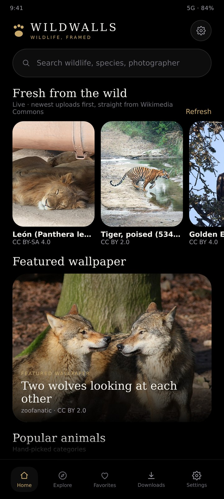
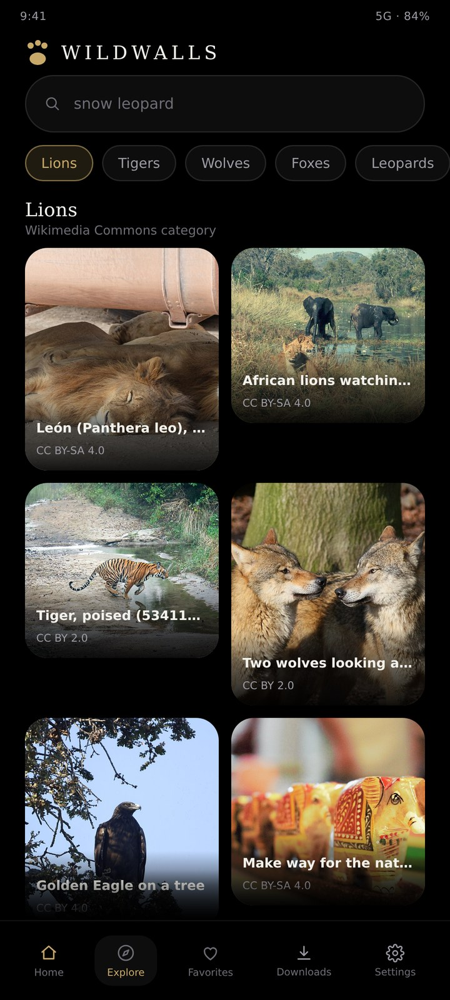
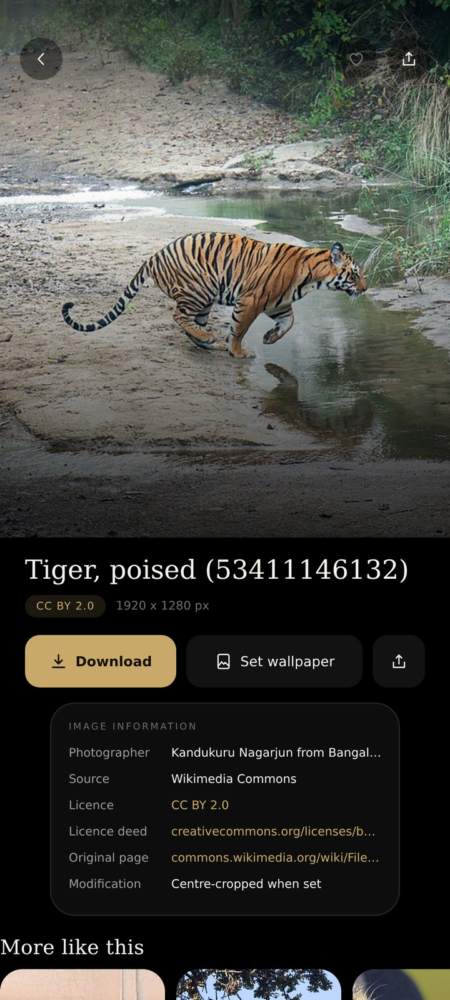
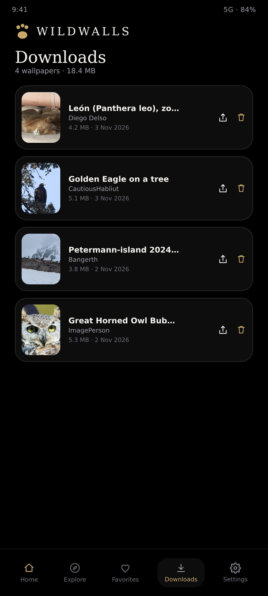
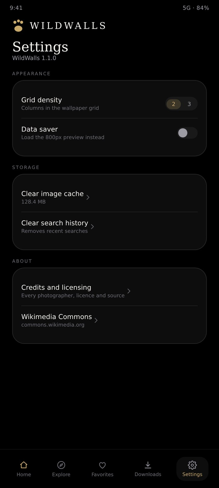

<h1 align="center">WildWalls</h1>
<p align="center"><b>Wildlife, framed.</b><br/>
A premium animal wallpaper app for Android — live photography from Wikimedia Commons,
verified free licensing, and the photographer credited on every single image.</p>

<p align="center">
  
  
  
</p>
<p align="center">
  
  
</p>

## Download

The latest APK is on the [Releases](../../releases) page: **WildWalls 1.1.0** (10.5 MB, minSdk 24,
Android 7.0+).

> The APK is signed with a debug key. If you installed an earlier WildWalls build, uninstall it
> first — a different signing key cannot update over an existing install.

## What it does

WildWalls is a browser for freely licensed wildlife photography. Nothing is bundled and nothing is
invented: every tile is a live Wikimedia Commons file fetched through the official MediaWiki API,
together with its photographer, licence and original file page.

- **Live, newest-first feed.** The home screen opens with "Fresh from the wild" — the newest uploads
  across six animal categories, requested with `gsrsort=create_timestamp_desc`, merged and sorted by
  Commons upload timestamp, and sent with `Cache-Control: no-cache` so it always reflects the network.
  It refreshes automatically when the app returns to the foreground.
- **24 categories** — lions, tigers, wolves, foxes, leopards, elephants, wild dogs, bears, deer,
  horses, cats, dogs, eagles, owls, parrots, snakes, crocodiles, sharks, whales, dolphins, penguins,
  butterflies, reptiles and endangered species. Every query was verified against the live API.
- **Search** with suggestions, pagination, loading and error states, and duplicate suppression.
- **Wallpaper actions** — download for offline use, set as home screen, lock screen or both
  (`WallpaperManager`, centre-cropped to the screen), favourite, and share with the credit attached.
- **Favourites, downloads and history** persist locally in Room; downloaded files stay available
  offline.
- **Credits screen** listing the licence policy, sources, and the full credit for every image saved.

## Licensing

`LicensePolicy` is a whitelist: an image is displayed only when its Commons licence is **CC0,
Public Domain, CC BY or CC BY-SA**. Unknown, non-free, fair-use, NoDerivatives and NonCommercial
material is filtered out before it reaches the screen. `CommonsMapper` additionally requires a real
bitmap photograph of at least 1000 × 1000 px, filed under the animal, and skips artwork, statues,
idols, engravings, maps and museum specimens.

Attribution is never dropped: title, photographer, licence, licence deed URL and the original file
page travel with each wallpaper into favourites, downloads, shares and the credits screen.
**WildWalls claims no ownership of any photograph.**

## Stack

Kotlin 1.9.24 · Jetpack Compose (BOM 2024.06) · Material 3 · Room 2.6.1 (KSP) · Retrofit 2.11 +
OkHttp 4.12 + Gson · Coil 2.6 · DataStore · Navigation Compose. minSdk 24, targetSdk 35.

```
ui/             Compose screens, one ViewModel each, navigation host + bottom bar
domain/model    Wallpaper, AnimalCategory, CategoryCatalog, LicensePolicy
data/remote     Retrofit API, Commons parameter interceptor, retry interceptor, DTOs, mapper
data/local      Room entities, DAO, database
data/repository WallpaperRepository (network), LibraryRepository (local), WallpaperCache
data/download   Streaming downloader      data/wallpaper  WallpaperManager integration
```

## Build

```bash
./gradlew assembleDebug     # app/build/outputs/apk/debug/app-debug.apk
./gradlew assembleRelease   # add your own signing config first
```

## Notes

- The User-Agent in `CommonsParamsInterceptor` carries a placeholder contact address
  (`contact@wildwalls.app`). Wikimedia asks clients to identify themselves — replace it with a real
  contact before publishing.
- **About the screenshots:** they are UI previews rendered from the app's own design system (palette,
  typography, spacing and layout of the Compose screens) using real Wikimedia Commons photographs.
  They are not captures from a physical device — the build environment had no emulator.
- Preview photographs are from Wikimedia Commons under their respective licences:
  Diego Delso (CC BY-SA 4.0), Kandukuru Nagarjun (CC BY 2.0), CautiousHabliut (CC BY 4.0),
  zoofanatic (CC BY 2.0), ImagePerson (CC BY 4.0), Bangerth (CC BY 4.0), Arbenllapashtica (CC BY 4.0),
  Remonhussain (CC BY-SA 4.0).
